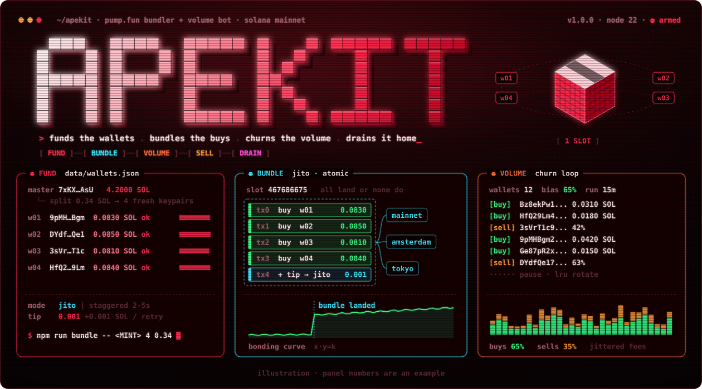
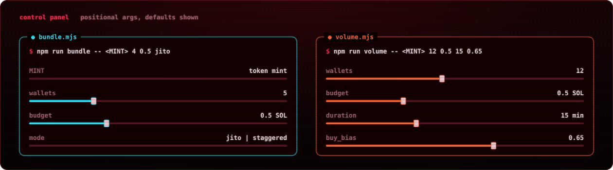
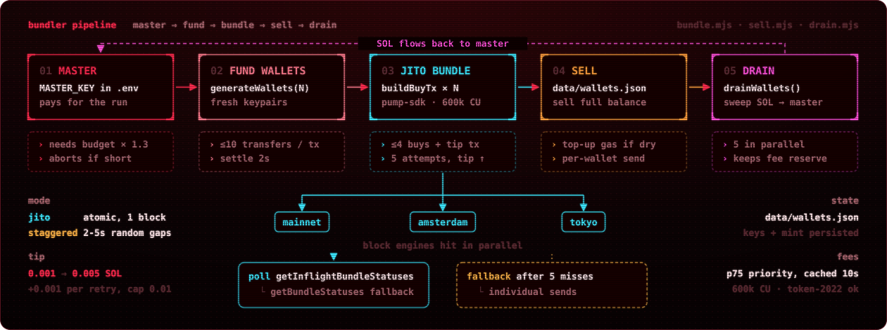
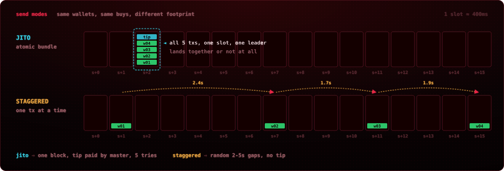
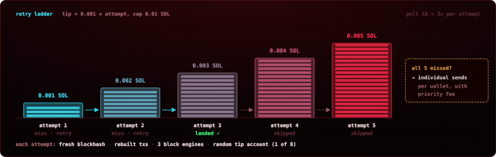
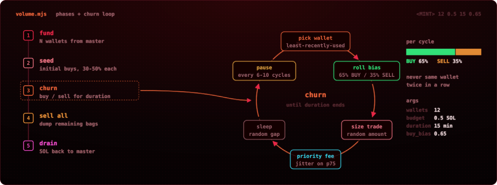
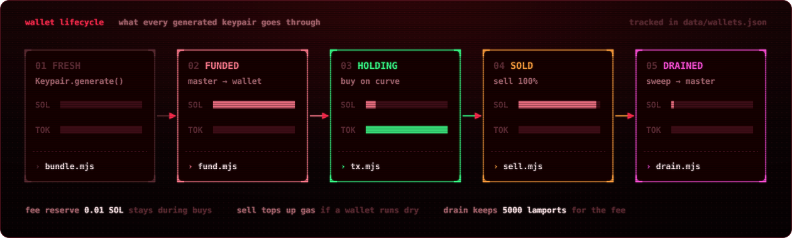
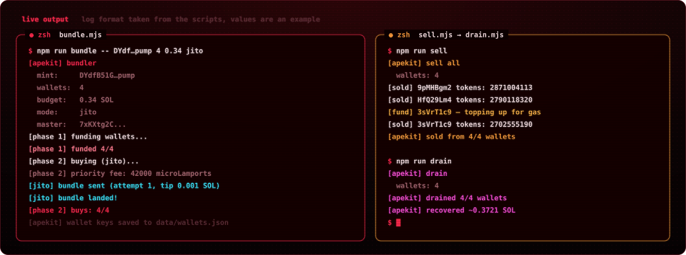
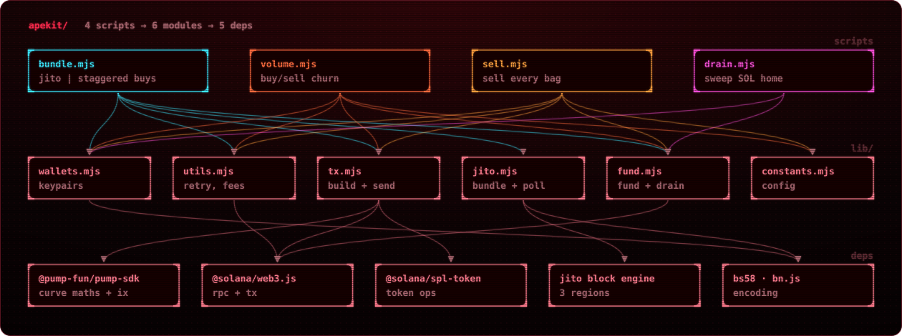

<p align="center"></p>

<p align="center">
  
  
  
  
  
  
</p>

<p align="center">
  <b><a href="#01--boot">[ boot ]</a></b> ·
  <b><a href="#02--bundler">[ bundler ]</a></b> ·
  <b><a href="#03--volume">[ volume ]</a></b> ·
  <b><a href="#04--exit">[ exit ]</a></b> ·
  <b><a href="#05--internals">[ internals ]</a></b> ·
  <b><a href="#06--rules">[ rules ]</a></b>
</p>

<p align="center">
  <code>fund</code> → <code>bundle</code> → <code>churn</code> → <code>sell</code> → <code>drain</code>
  &nbsp;·&nbsp; four scripts, six modules, zero paid APIs
</p>

<p align="center"></p>

<a id="01--boot"></a>

<p align="center"></p>

```bash
git clone https://github.com/zostaff/apekit.git && cd apekit
npm install                      # Node.js 22+, ESM only
cp .env.example .env             # RPC + master key
```

```env
RPC_URL=https://mainnet.helius-rpc.com/?api-key=YOUR_KEY
MASTER_KEY=your_base58_private_key
```

The master wallet pays for everything: it funds the generated wallets, pays the Jito tip and
receives every lamport back on `drain`. `.env`, `keys/` and `data/` are git-ignored.

```bash
npm run bundle -- <MINT> 4 0.5 jito          # multi-wallet buy in one slot
npm run volume -- <MINT> 12 0.5 15 0.65      # buy/sell churn for 15 min
npm run sell                                 # dump every bag from data/wallets.json
npm run drain                                # sweep all SOL back to master
```

<p align="center"></p>

<p align="center"></p>

<a id="02--bundler"></a>

<p align="center"></p>

Buy one token from N fresh wallets at the same time, either inside a single **Jito bundle**
(atomic: every buy lands in the same block or none do) or as **staggered** individual sends.

<p align="center"></p>

| # | Param | Default | Description |
|---|-------|---------|-------------|
| 1 | `MINT` | — | token mint address |
| 2 | `wallets` | `5` | number of buy wallets |
| 3 | `budget` | `0.5` | total SOL to spend |
| 4 | `mode` | `jito` | `jito` or `staggered` |

**Pipeline**

1. **Master.** Checks the balance covers `budget × 1.3` plus fees, aborts if it doesn't.
2. **Fund.** Generates fresh keypairs and funds them from master, up to 10 transfers per tx.
3. **Build.** One pump.fun buy per wallet via `@pump-fun/pump-sdk` (600k CU, Token-2022 aware).
4. **Send.** Jito bundle, or one tx at a time with random 2-5s gaps.
5. **Persist.** Keys and mint go to `data/wallets.json` so `sell` and `drain` can pick them up.

<p align="center"></p>

> [!IMPORTANT]
> A Jito bundle carries at most **5 transactions**, and the tip is its own tx.
> Keep `wallets ≤ 4` in `jito` mode. With more wallets the bundle gets rejected and the run falls back to individual sends.

### Retry ladder

Each attempt grabs a fresh blockhash, rebuilds every tx, picks a random tip account (1 of 8)
and fires the bundle at all three block engines (`mainnet`, `amsterdam`, `tokyo`) in parallel.
Status is polled with `getInflightBundleStatuses`, falling back to `getBundleStatuses`.

<p align="center"></p>

<p align="center"></p>

<a id="03--volume"></a>

<p align="center"></p>

Multi-wallet buy/sell cycling on one token for a fixed duration.

```bash
npm run volume -- <MINT> 12 0.5 15 0.65
```

| # | Param | Default | Description |
|---|-------|---------|-------------|
| 1 | `MINT` | — | token mint address |
| 2 | `wallets` | `12` | number of trading wallets |
| 3 | `budget` | `0.5` | total SOL budget |
| 4 | `duration` | `15` | minutes to run |
| 5 | `buy_bias` | `0.65` | probability a cycle is a buy (0-1) |

<p align="center"></p>

- **Seed.** Every wallet first buys with 30-50% of its balance.
- **Rotation.** Least-recently-used pick, never the same wallet twice in a row.
- **Bias.** 65% buy / 35% sell by default, sells take a random portion of the bag.
- **Timing.** Random trade sizes and gaps, a longer pause every 6-10 cycles.
- **Fees.** Priority fee pulled from chain (p75), jittered per tx.
- **Wrap-up.** Sells everything left, then drains SOL back to master.

<p align="center"></p>

<a id="04--exit"></a>

<p align="center"></p>

After a bundle run, the wallets in `data/wallets.json` still hold the tokens.

```bash
npm run sell     # sell 100% from every wallet, tops up gas if a wallet is dry
npm run drain    # sweep remaining SOL to master, 5 wallets in parallel
```

<p align="center"></p>

<p align="center"></p>

<p align="center"></p>

<a id="05--internals"></a>

<p align="center"></p>

<p align="center"></p>

```
apekit/
├── bundle.mjs          # bundler: jito or staggered buys
├── volume.mjs          # volume bot: buy/sell cycling
├── sell.mjs            # sell all tokens from wallets
├── drain.mjs           # drain SOL back to master
├── lib/
│   ├── constants.mjs   # config, jito endpoints, tip accounts
│   ├── wallets.mjs     # wallet generation, master key
│   ├── utils.mjs       # retry, blockhash manager, priority fees
│   ├── tx.mjs          # tx building, pump.fun sdk integration
│   ├── jito.mjs        # bundle send + status polling
│   └── fund.mjs        # wallet funding + draining
└── assets/             # svg art, regenerate: python3 assets/gen_assets.py
```

<details>
<summary><b>Technical notes</b></summary>

| | |
|---|---|
| pump.fun | V3 via `@pump-fun/pump-sdk` (bonding curve maths + instructions) |
| compute | 600,000 CU per tx, Token-2022 compatible |
| jito | 3 block engines in parallel, 8 tip accounts, 5 attempts |
| tip | `0.001 × attempt` SOL, hard cap 0.01 |
| polling | `getInflightBundleStatuses` → `getBundleStatuses`, 10 × 3s |
| priority fee | p75 from chain, cached 10s, clamped 1k-100k µLamports |
| funding | ≤10 transfers per tx, `budget × 1.3` headroom, 2s settle |
| reserve | 0.01 SOL kept per wallet during buys |

</details>

<details>
<summary><b>Dependencies</b></summary>

| Package | Why |
|---|---|
| `@solana/web3.js` | RPC, transactions |
| `@solana/spl-token` | token accounts |
| `@pump-fun/pump-sdk` | bonding curve maths + buy/sell instructions |
| `bn.js` | BigNumber for SDK compatibility |
| `bs58` | base58 key encoding |

</details>

<p align="center"></p>

<a id="06--rules"></a>

<p align="center"></p>

- **Research and education only.** This code shows how pump.fun bundlers and volume bots work,
  so traders can recognise them on-chain.
- Coordinated buying and self-matched volume can break platform terms and, depending on where
  you live, market-manipulation or wash-trading laws. You are responsible for how you use it.
- It moves real SOL from a real private key. Use a burner master wallet and test with tiny amounts.
- Never commit `.env`, `keys/` or `data/wallets.json`: they hold private keys.
- No warranty. Bundles can fail, fees are spent either way, and tokens can go to zero.

<p align="center"><sub>illustrations are generated from <code>assets/gen_assets.py</code> · panel numbers are examples</sub></p>
